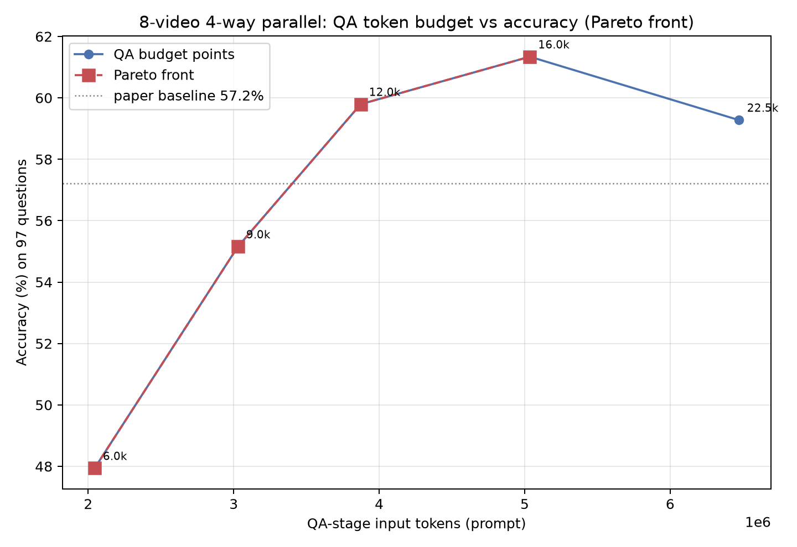

# 8-video 4-way parallel experiment (m3_parallel4_paper8_20261113)

Model: MiniMax-M3.1-Flash (thinking=adaptive, reasoning_effort=medium). Branch: rychkov/m3-parallel. Fresh pgvector DB. 97 questions, 8 videos.

## Accuracy (approx. reproduction)

- Questions judged: **97**  (missing/errored treated as 0)
- Mean score (oGMemory): **63.92%**  vs paper baseline **57.216%** (delta +6.70 pp)

| video | questions | score | acc % | paper acc % | delta pp |
|---|---|---|---|---|---|
| study_09 | 12 | 7.50 | 62.50 | 58.33 | +4.17 |
| kitchen_01 | 13 | 4.50 | 34.62 | 38.46 | -3.84 |
| bedroom_05 | 12 | 6.00 | 50.00 | 41.67 | +8.33 |
| study_23 | 14 | 10.50 | 75.00 | 67.86 | +7.14 |
| kitchen_23 | 12 | 9.50 | 79.17 | 54.17 | +25.00 |
| study_05 | 12 | 7.50 | 62.50 | 45.83 | +16.67 |
| gym_03 | 11 | 7.50 | 68.18 | 72.73 | -4.55 |
| bedroom_04 | 11 | 9.00 | 81.82 | 81.82 | -0.00 |

## Token usage by stage

| stage | videos | prompt tok | completion tok | cached tok |
|---|---|---|---|---|
| pipeline | 8 | 2510031 | 785051 | 604837 |
| qa | 8 | 6595333 | 123015 | 943033 |
| judge | 97 | 60973 | 9935 | 18527 |
| **total** | | **9166337** | **918001** | **1566397** |

## Wall-clock timing

| stage | seconds | minutes |
|---|---|---|
| 8x pipeline | 21541.2 | 359.0 |
| 8x qa | 1266.1 | 21.1 |
| **pipeline+qa total** | **22807.4** | **380.1** |

### Per-video stage timings (authoritative receipts)

| video | pipeline (s) | qa (s) | pipeline (min) |
|---|---|---|---|
| study_09 | 2820.0 | 160.3 | 47.0 |
| kitchen_01 | 163.4 | 120.2 | 2.7 |
| bedroom_05 | 1764.7 | 111.6 | 29.4 |
| study_23 | 2385.8 | 152.0 | 39.8 |
| kitchen_23 | 2435.9 | 30.8 | 40.6 |
| study_05 | 4058.5 | 235.2 | 67.6 |
| gym_03 | 4097.1 | 247.8 | 68.3 |
| bedroom_04 | 3815.8 | 208.2 | 63.6 |

## QA token-budget Pareto front

Same frozen graph; only `m3.qa_context.max_input_tokens` varies. Effective cap = min(budget, 32768-8192-2048=22528).

| budget | effective | QA input tok | QA output tok | accuracy % |
|---|---|---|---|---|
| 6000 | 6000 | 2044084 | 77082 | 47.94 |
| 9000 | 9000 | 3029175 | 94694 | 55.15 |
| 12000 | 12000 | 3873144 | 102980 | 59.79 |
| 16000 | 16000 | 5035616 | 120339 | 61.34 |
| 22528 | 22528 | 6471426 | 117639 | 59.28 |

Pareto-front points: [6000, 9000, 12000, 16000]

## Caveats

- This branch dropped `fact_index` and uses a reduced `qa_context` schema, so this is an *approximate* re-run, not byte-identical to the 57.2% paper baseline.
- QA budgets above 22528 are clamped by the runtime (context_window - qa_out - safety).
- Judge = MiniMax-M3.1-Flash, temperature 0, deterministic seed 20261113.

## QA token-budget Pareto sweep (multi-seed, n=2)

Fixed memory/graph; only `m3.qa_context.max_input_tokens` varied; QA re-run + re-judged (97 Q) per replicate.

| budget | n | acc mean±std (%) | QA in (M) | QA out (M) | QA sec (mean) |
|---|---|---|---|---|---|
| 3000 | 2 | 7.73 ± 1.46 | 0.754 | 31.0k | 618 |
| 4000 | 2 | 27.32 ± 8.02 | 1.130 | 48.8k | 844 |
| 6000 | 2 | 47.16 ± 1.09 | 2.015 | 75.8k | 1060 |
| 9000 | 2 | 57.47 ± 3.28 | 3.013 | 93.1k | 1206 |
| 12000 | 2 | 57.22 ± 3.64 | 3.891 | 103.1k | 6512 |
| 16000 | 2 | 58.25 ± 4.37 | 4.960 | 114.5k | 1597 |
| 22528 | 2 | 61.60 ± 3.28 | 6.533 | 120.3k | 16387 |

Notes: 12000 & 22528 wall-times are inflated by quota waits (not pure compute). 22528 = baseline(63.92%) + single-seed sweep(59.28%) as 2 independent full-context runs. 6000-16000 = existing single seed + one new repeat. 3000/4000 new, 2 reps each.
