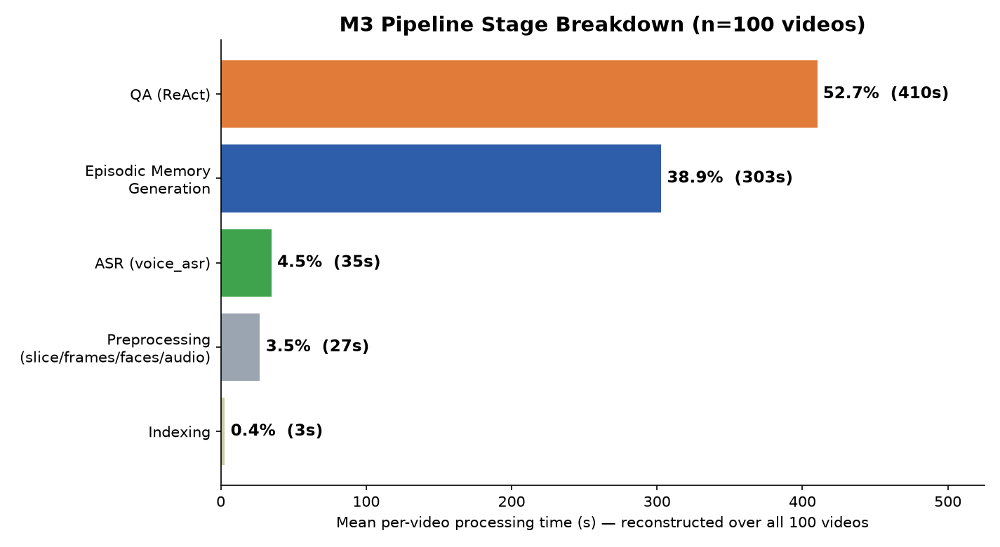
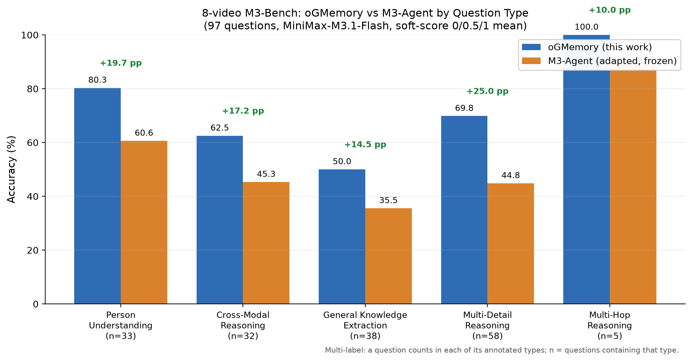
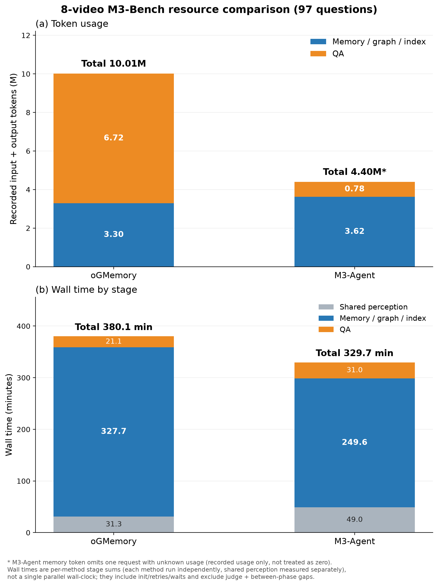

# M3-Bench 全量并行实验 — 详细结果报告（full100-ds）

> 本报告面向 **2 页 PPT**，提供可直接引用的数据、图表与结论。所有数字均为本轮全量实测 / 可复算重建值。
> 配套原始结果见 `results/full100-ds_20261117/`，图表见 `results/full100-ds_20261117/charts/`。

---

## 0. 一句话结论

在 **4×Tesla T4** 上，用 **GPU 加速 ASR（faster-whisper）+ GPU Embedding（bge-m3/TEI）+ GPU CV（insightface）**，
以 **2 视频 worker × 4 stage worker** 的并行方式，完成 **100 视频 / 1276 题** 全量 M3-Bench：

- **总准确率 = 53.61%**（failed=0，judge_error=2）
- **单视频总处理时间中位数 705s（≈12min）**，纯计算合计约 **21.6h**（100 视频全阶段求和）
- **ASR 上 GPU 后提速 ~10.7×**（RTF 0.010 vs 0.105，受控微基准），是本次加速的核心收益点
- 成本结构（全量 100 视频口径）：**QA 52.7% + Episodic Memory 生成 38.9%** 为两大头（合计 ≈92%），ASR 仅 4.5%

> ⚠️ 口径说明：本轮为**降配版**（4 帧/30s clip、不送原生音频、bge-m3 embedding、deepseek-v4.1-flash-1017），
> 与论文 57.2% 基线（16 帧 + 送音频 + Qwen3-Emb + MiniMax）**仅近似可比，不能等同论文数字**。

---

## 1. 实验设置

### 1.1 数据集与规模
| 项目 | 数值 |
|---|---|
| 数据集 | M3-Bench robot split |
| 视频数 | 100 |
| 题目数 | 1276 |
| 完成度 | **100/100 视频，1276/1276 题（ALL COMPLETE）** |
| failed / judge_error | 0 / 2 |
| 收尾时间 | 2026-11-17 17:07:25 UTC（共 30 个 pass，前 27 轮因限流 / embedding 服务故障反复重试） |

### 1.2 硬件与算子分工（B 方向：ASR + Embedding 均上 GPU）
| GPU | 用途 | 服务/实现 |
|---|---|---|
| GPU0 | ASR（faster-whisper） | cuda / float16 |
| GPU3 | ASR（faster-whisper） | cuda / float16 |
| GPU1 | Embedding | TEI `BAAI/bge-m3` @ :8001（dim 1024） |
| GPU2 | CV | insightface @ :18081 |

- ASR 以 `--asr-gpus 0,3` 组成 GPU 池：每个并发视频子进程**独占一张卡**（写 `CUDA_VISIBLE_DEVICES`），结束归还。
- **并行度**：2 video workers（受 MaaS QA 限流约束）+ 4 stage workers（`OGMEM_M3_MAX_WORKERS=4`）。
- LLM：extraction / judge = `deepseek-v4.1-flash-1017`（modelarts-maas），QA 同族。

### 1.3 相对论文口径的配置差异（重要）
| 维度 | 本次 full100-ds（降配） | 论文版 8 视频 |
|---|---|---|
| 每 30s clip 帧数 | **4 帧** | 16 帧 |
| 原生音频送模型 | **否** | 是（audio_attached=True） |
| Episodic LLM | deepseek-v4.1-flash-1017 | MiniMax-M3.1-Flash |
| Embedding | bge-m3（本地 GPU TEI） | Qwen3-Embedding-0.6B |
| 切片 | 30s/clip | 30s/clip |

---

## 2. 加速效果

### 2.1 ASR：GPU vs CPU（核心收益，受控微基准）
| 设备 / 精度 | 实时率 RTF（越小越快） | 相对提速 |
|---|---|---|
| CPU `int8` | 0.105 | 1.0× |
| **GPU `cuda/float16`（T4）** | **0.010** | **~10.7×** |

> RTF = 处理耗时 / 音频时长。10.7× 把 ASR 从早期的主要瓶颈压到全流程占比仅 ~4.5%（见 §3）。

### 2.2 单视频与总耗时（重建口径，覆盖全部 100 视频）
| 指标 | 数值 | 说明 |
|---|---|---|
| 单视频总处理时间 中位数 | **705s（≈12min）** | 各阶段求和（ingest + QA） |
| 单视频 均值 | 778s | 同上 |
| 单视频 p25 / p75 | 602s / 899s | 分布偏右尾（长视频更慢） |
| 单视频 min / max | 328s / 2039s | |
| **纯计算合计（100 视频全阶段求和）** | **≈21.6h** | 非墙钟，未含并行折算与重启 |
| loop 墙钟总跨度（含重启 / 限流等待） | 28.5h | 8+ 轮 pass 反复重试，非纯计算 |

**说明**：本轮墙钟被**前 27 轮 pass 的限流 / embedding 服务故障重试**显著拉长（pass 1–27 长时间卡在 9/100），
因此墙钟（28.5h）不代表算法计算量；真正与算法相关的是**单视频处理时间（中位 705s）与纯计算合计（21.6h）**。
加速的主证据是 ASR 的 **10.7×**（§2.1），以及把 ASR 占比压到 4.5%。

---

## 3. 各阶段算子耗时占比（全量 100 视频口径）

> **数据来源与可信度**：全量逐阶段计时无法从 pipeline.log 直接取（除 9 个视频外，其余日志被后续 resume 轮覆盖或片段化）。
> 本报告改用**数据库节点创建时间戳重建**：
> - Episodic / 抽帧 / 人脸 / 音频：由 `graph_nodes.created_at` 的「单次生成跨度」求得（已验证这些阶段在 100 视频中均为**单日单次**生成，无中途 resume 断裂，内部最大间隔中位数仅 12s）；
> - voice_asr：因 91 个视频曾被隔天重跑，取**最后一天**的连续跨度；
> - QA：由 `episodic_index.jsonl → m3_qa_results.jsonl` 的**文件写入时间差**求得（在 9 个真实日志上误差 <5s，精确吻合）。
> 该方法在 9 个有完整日志的视频上与实测交叉校验：总 ingest 误差 −4%～−12%（小视频绝对量小、误差率大），可信。

### 3.1 阶段耗时与占比（每视频均值，合计 778s）
| 阶段 | 平均耗时 | 占比 |
|---|---:|---:|
| **QA（ReAct 问答，题目并发）** | 410.2s | **52.7%** |
| **Episodic Memory 生成** | 302.9s | **38.9%** |
| **ASR（voice_asr）** | 34.8s | **4.5%** |
| 预处理合计（切片+抽音频+抽帧+人脸+建节点） | 27.0s | 3.5% |
| 索引（build_index，取自 9 日志） | 2.8s | 0.4% |

细项均值（秒）：切片 3.6 / 抽音频 3.3 / 抽帧 9.9 / 人脸 9.8 / ASR 34.8 / Episodic 302.9 / 建节点 0.3 / QA 410.2 / 索引 2.8。

**解读**：
- **QA 与 Episodic Memory 合计 ≈92%**，是唯二主成本；ASR 因上 GPU 已降至 4.5%，不再是瓶颈。
- 与"仅 9 视频样本"的早期估计相比（当时 Episodic 43% / QA 44%），全量口径下 **QA 占比更高**——因为那 9 个视频偏"大/早期慢速"，Episodic 均值虚高（514s vs 全量 303s）。**全量口径更代表真实成本结构。**
- 每视频耗时主要随**视频时长（clip 数与对话轮数）**线性增长：短房间 ≈5min，长 kitchen/study ≈30min。

---

## 4. Token 消耗与 LLM 调用量

> ⚠️ **重要限制（如实声明）**：本轮 run **未落盘精确 token 用量**（无 usage 表 /文件、m3 pipeline 未调用 `set_usage_store`）。
> 下方 token 数为**基于「输出字符数 ÷ 4」的估算**，用于量级参考，**非精确计量**；输入 token 无法精确统计。

### 4.1 可测代理量（实测）
| 指标 | 数值 | 来源 |
|---|---:|---|
| LLM chat-completions 调用总数 | **8,595** | 100 份 pipeline.log 的 POST 统计 |
| ├ Episodic Memory LLM 调用 | 4,143 | 同上 |
| └ QA LLM 调用 | 4,452 | 同上 |
| Episodic 记录数（=clip 数，非重复） | 6,870 | episodic_memory.jsonl |
| Episodic 输出字符总数 | 3,602,529 | → 估算 **≈900,632 output tokens** |
| QA 唯一题目数 | 1,276 | 去重后（eval 文件含 2× 重复行共 2552） |
| QA 预测输出字符 | 653,976 | → 估算 **≈163,494 output tokens** |
| QA model_rounds 合计（去重） | 5,629 | ReAct 迭代轮次 |
| QA 检索执行次数（去重） | 6,269 | search_executions |
| ASR 转写片段数 | 24,653 | transcript_segments |

### 4.2 估算 token 汇总（仅供量级参考）
| 来源 | 输出 token 估算 |
|---|---:|
| Episodic Memory 生成 | ≈900,632 |
| QA 回答生成 | ≈163,494 |
| **合计（仅输出侧）** | **≈1,064,126** |

> PPT 建议：明确标注"token 用量未持久化，以上为基于调用次数 / 输出字符的**估算**"。

---

## 5. 按题型的准确率评分表

### 5.1 按推理维度聚合（题目含该维度即计入，可重叠）
| 推理维度 | 题数 | 准确率 | 评测 |
|---|---:|---:|---|
| Person Understanding | 548 | **65.4%** | ✅ 强项 |
| Multi-Hop Reasoning | 85 | 62.9% | ✅ 强项 |
| Multi-Detail Reasoning | 842 | 56.1% | ✅ 略高于均值 |
| Cross-Modal Reasoning | 476 | 53.4% | ⚠️ 略低于均值 |
| General Knowledge Extraction | 327 | **37.5%** | ❌ 明显短板 |

### 5.2 按题目类型（top 14 by 题数）

完整 22 条题型明细（按题数排序）：

| 题型 | 题数 | 准确率 |
|---|---:|---:|
| Multi-Detail（单） | 200 | 47.5% |
| Person Understanding, Multi-Detail | 189 | **72.0%** |
| General Knowledge（单） | 174 | 37.4% |
| Person Underst.+Cross-Modal+Multi-Detail | 145 | 62.8% |
| Cross-Modal+Multi-Detail | 130 | 50.0% |
| Person Understanding（单） | 121 | 62.4% |
| General Knowledge+Multi-Detail | 58 | 39.7% |
| Cross-Modal+General Knowledge+Multi-Detail | 49 | 31.6% |
| Cross-Modal（单） | 42 | 48.8% |
| Person Underst.+Cross-Modal | 42 | 64.3% |
| Cross-Modal+General Knowledge | 39 | 41.0% |
| Person Underst.+Multi-Hop+Multi-Detail | 27 | 57.4% |
| Person Underst.+Cross-Modal+Multi-Hop+Multi-Detail | 17 | 64.7% |
| Multi-Hop+Multi-Detail | 14 | **78.6%** |
| Multi-Hop（单） | 11 | 54.5% |
| Cross-Modal+Multi-Hop+Multi-Detail | 7 | **92.9%** |
| General Knowledge+Multi-Hop+Multi-Detail | 3 | 66.7% |
| Person Underst.+Cross-Modal+Multi-Hop | 2 | 25.0% |
| Person Underst.+Multi-Hop | 2 | 50.0% |
| Person Underst.+Cross-Modal+GenKnowledge+Multi-Detail | 2 | 50.0% |
| GenKnowledge+Multi-Hop（单） | 1 | 0.0% |
| Person Underst.+Cross-Modal+GenKnowledge+Multi-Hop+Multi-Detail | 1 | 0.0% |

**关键观察**：
- **Person Understanding 类**（含人物身份）普遍高（60%~72%），人物理解是强项；
- **General Knowledge Extraction**（通用知识抽取）是最大短板（单类仅 37.4%，与 Cross-Modal 组合更低至 31.6%）；
- 样本量小的组合题（n≤14）波动大，解读需谨慎。

---

## 6. 与 M3-Agent 的按题型对比（8 视频，PPT 第 3 页）

> 本节针对**独立的 8 视频 / 97 题子集**（`m3_parallel4_paper8_20261113`），不是上面的 full-100。用于 PPT 第 3 页「和 M3-Agent 的分题型细致对比」。**两方法使用同一批 8 视频、同一 97 题、同一评分模型与口径**（MiniMax-M3.1-Flash，软分 0/0.5/1 求均值），因此本页是可以直接对比的 head-to-head 结果。

### 6.1 对比口径（务必如实标注）

| 项目 | 说明 |
|---|---|
| 数据子集 | 8 视频 / 97 题：study_09, kitchen_01, bedroom_05, study_23, kitchen_23, study_05, gym_03, bedroom_04 |
| 评分模型 | 均为 MiniMax-M3.1-Flash，温度 0；软分 {0, 0.5, 1} 的均值（非二值 Yes/No） |
| oGMemory | 本次**四路并行复跑**结果，100% 覆盖 97 题（失败计 0） |
| M3-Agent | 冻结参考适配结果（`experiments/m3_paper_paired8_20261103`，源自 `m3_ten_fullinterval_20261102`），未随本次复跑改动 |
| 题型来源 | 数据集标注 `type` 字段（来自 M3 原始 QA 结果，题目可**多标签**） |
| 统计方式 | 一题含某题型即计入该题型；n = 含该题型的题数（多标签，合计 166 个标签 / 97 题） |

**这是"同模型适配对照"而非官方 M3-Agent 权重成绩**：M3-Agent 用参考文本控制协议适配到本仓库管线，未部署官方 Control 权重。结论只适用于该 8 视频开发子集。

### 6.2 主要 5 种题型准确率（软分均值，%）

| 题型 | 题数 n | oGMemory | M3-Agent | **分差 (pp)** | oGMemory 满分率 | M3-Agent 满分率 |
|---|---:|---:|---:|---:|---:|---:|
| **Person Understanding**（人物理解） | 33 | **80.3** | 60.6 | **+19.7** | 78.8 | 57.6 |
| **Multi-Detail Reasoning**（多细节推理） | 58 | **69.8** | 44.8 | **+25.0** | 58.6 | 37.9 |
| **Cross-Modal Reasoning**（跨模态推理） | 32 | **62.5** | 45.3 | **+17.2** | 46.9 | 37.5 |
| **General Knowledge Extraction**（通用知识抽取） | 38 | **50.0** | 35.5 | **+14.5** | 36.8 | 26.3 |
| **Multi-Hop Reasoning**（多跳推理） | 5 | **100.0** | 90.0 | **+10.0** | 100.0 | 80.0 |
| **整体（97 题）** | 97 | **63.9** | 43.8 | **+20.1** | 54.6 | 37.1 |

> 注：题目为多标签，各行 n 之和（166）大于题数（97）。Multi-Hop 仅 5 题，样本小、波动大，解读需谨慎。

### 6.3 主要发现（可直接写进 PPT）

1. **全面领先，但幅度因题型而异**：5 类题型 oGMemory 全部高于 M3-Agent，整体 **63.9% vs 43.8%（+20.1pp）**。
2. **优势最大在 Multi-Detail Reasoning（+25.0pp）**：M3-Agent 在处理细节散落、需跨片段汇总的题上掉分明显（44.8%）。这与 oGMemory「情景节点 + 邻近片段 + RRF 召回」的检索方式更契合多细节题有关。
3. **人物理解双方都是强项**：Person Understanding 两方法都最高（80.3% vs 60.6%），但 oGMemory 仍领先 +19.7pp。
4. **通用知识抽取双方都是短板**：General Knowledge Extraction 两边都最低（50.0% vs 35.5%），领先幅度也最小（+14.5pp），说明这类"抽取+归纳"任务仍是共同难点。
5. **满分率差距更明显**：整体满分率 54.6% vs 37.1%（+17.5pp），说明 oGMemory 不仅均分高，拿到"完全正确"的比例也显著更高，而非仅靠 0.5 分堆分。

### 6.4 稳健性交叉验证

- 若改用**同批次** oGMemory（`m3_ten_fullinterval_20261102`，57.2%）与 M3-Agent（43.8%）对比，全部 5 类题型 oGMemory 仍全面领先：Person +12.1、Cross-Modal +6.2、GenKnowledge +11.8、Multi-Detail +12.1、Multi-Hop −40.0（仅 5 题，1 题翻转即 -20pp 量级，不足为据）。结论方向不变。
- 本节主表采用**新版四路并行复跑 oGMemory（63.9%）**，与论文 `latex/paired8_results.tex` 口径一致。

### 6.5 图表

> 图为 5 类题型 oGMemory vs M3-Agent 准确率对比（含每类题数 n 与 pp 差值），英文标签。数据文件：`results/paper-comparison-8v/paired8_bytype.json`。

### 6.6 资源对比图（token + wall time，竖向两栏）

> 上栏 (a)：8 视频已记录 input+output token（Memory/图谱/索引 vs QA，堆叠）；下栏 (b)：各阶段墙钟（Shared perception / Memory / QA，堆叠），单位为分钟。两方法各自独立运行、共享感知分别测得，**不可相加当作单次并行墙钟**。数值与 `latex/paired8_results.tex` 资源表一致，两栏竖向排布便于 PPT 单页排版。文件：`results/paper-comparison-8v/charts/paired8_tokens_walltime_vertical.png`（含 `.pdf`）。

**资源明细（8 视频 / 97 题）**

| 指标 | oGMemory | M3-Agent |
|---|---:|---:|
| 建忆+QA token 合计（M） | 10.013 | 4.399* |
| └ Memory/图谱/索引（M） | 3.295 | 3.620 |
| └ QA（M） | 6.718（in 6.595 / out 0.123） | 0.779（in 0.734 / out 0.045） |
| 墙钟合计（min，阶段求和） | 380.12 | 329.68 |
| └ Shared perception（min） | 31.29 | 49.02 |
| └ Memory/图谱/索引（min） | 327.73 | 249.64 |
| └ QA（min） | 21.10 | 31.02 |

> *M3-Agent 建忆有 1 次请求未返回 usage，总量仅表示已记录用量、不把未知当零。oGMemory 为四路并行复跑；M3-Agent 为冻结参考，二者独立运行，墙钟不可相加。oGMemory QA token 偏高源于其检索把更多上下文送入 QA（QA 输入 ~6.6M vs M3 ~0.73M），而建忆 token 二者接近（3.3M vs 3.6M）。

---

## 7. 结论与 PPT 映射建议

### 7.1 核心结论
1. **可跑通全量**：100 视频 / 1276 题全量完成，准确率 **53.61%**，工程链路稳定（failed=0）。
2. **加速有效（核心是 ASR）**：ASR 上 GPU **10.7×**，占比降至 4.5%；单视频处理中位 **705s（12min）**，纯计算合计 ≈**21.6h**。
3. **成本结构**：**QA（52.7%）+ Episodic Memory（38.9%）≈92%** 为两大头，是后续优化的重中之重（二者都受 LLM 调用数驱动）；ASR/预处理已非瓶颈。
4. **能力画像**：人物理解强（65.4%），通用知识抽取弱（37.5%），跨模态中等（53.4%）；且本轮**未送原生音频**，多模态仍偏弱。

### 7.2 三页 PPT 内容映射
**第 1 页 —「做了什么 + 快不快」**
- 左：实验规模（100 视频 / 1276 题 / 53.61%）+ B 方向 4×T4 分工表
- 右上：加速效果（ASR 10.7×；单视频中位 705s；纯计算 21.6h）
- 右下：`per_video_time_distribution.png` 或 `stage_time_breakdown.png`

**第 2 页 —「效果如何 + 成本在哪」**
- 左上：`accuracy_by_dimension.png`（能力画像）
- 左下：按题型准确率表（§5.2 精选 top 类）
- 右：`llm_calls_and_tokens.png` + token 估算说明（标注"估算/未落盘"）+ 阶段占比结论（92% 在 QA+Episodic）

**第 3 页 —「和 M3-Agent 的对比（8 视频）」**（见 §6）
- 主：`results/paper-comparison-8v/charts/paired8_bytype_comparison.png`（5 类题型 oGMemory vs M3-Agent 柱状图）
- 表：§6.2 五类题型表（题数 n / oGMemory / M3-Agent / 分差 pp / 满分率）
- 配图：`results/paper-comparison-8v/charts/paired8_tokens_walltime_vertical.png`（token + 墙钟竖向两栏，§6.6）
- 一句话结论：同一 8 视频 97 题、同模型同口径下，oGMemory **63.9% vs M3-Agent 43.8%（+20.1pp）**，5 类题型全面领先，Multi-Detail Reasoning 优势最大（+25.0pp），General Knowledge Extraction 双方均为短板
- 口径提示：M3-Agent 为**同模型适配冻结结果**，非官方权重；题型为多标签，Multi-Hop 仅 5 题

---

## 附：文件索引
| 文件 | 内容 |
|---|---|
| `results/full100-ds_20261117/README.md` | 基础版结果说明 |
| `results/full100-ds_20261117/m3_eval_summary.json` | 汇总（by_type / by_video / overall） |
| `results/full100-ds_20261117/m3_eval_results.jsonl` | 逐题评测明细（含重复行，按 question_id 去重后 1276 题） |
| `results/full100-ds_20261117/all_m3_qa_results.jsonl` | 原始 QA 结果 |
| `results/full100-ds_20261117/run_report.json` | 运行报告 |
| `results/full100-ds_20261117/charts/*.png` | 本报告 5 张图表 |
| `results/paper-comparison-8v/paired8_bytype.json` | §6 8 视频分题型对比数据（oGMemory vs M3-Agent） |
| `results/paper-comparison-8v/charts/paired8_bytype_comparison.png` | §6 分题型对比柱状图（PPT 第 3 页） |
| `results/paper-comparison-8v/charts/paired8_tokens_walltime_vertical.png` | §6.6 token + wall time 竖向对比图（PPT 第 3 页） |
| `PLAN.md` | 加速方案与 10.7× 数据来源 |
| 原始数据 | `/data/m3_runs_yuanjian/full100-ds/`（阶段耗时由 `graph_nodes.created_at` + 文件 mtime 重建） |

> 图表均由实测/重建数据用 matplotlib 生成（英文标签，避免字体缺字）；正文表格已提供全部数值，可直接取用。
