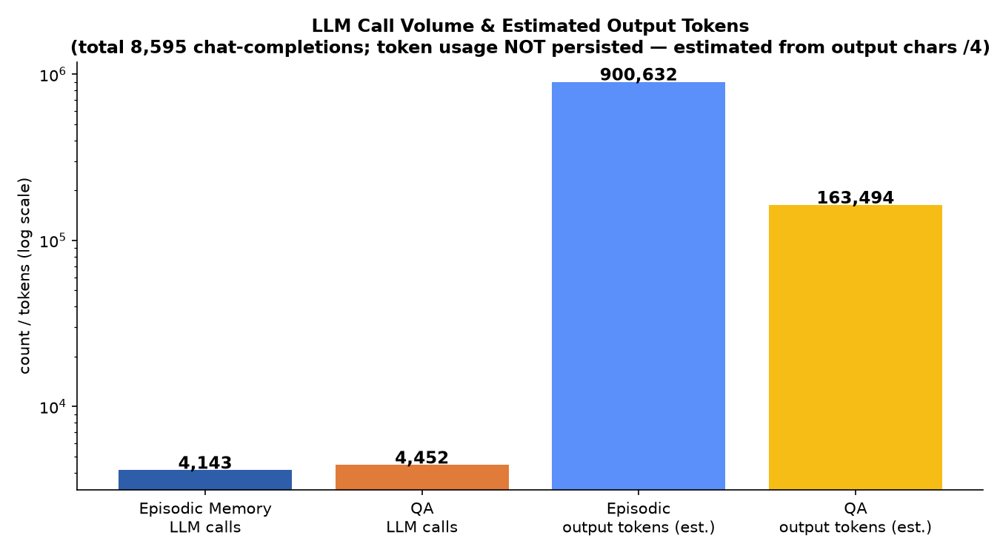

# M3-Bench 全量并行实验 — 详细结果报告（full100-ds）

> 本报告面向 **2 页 PPT**，提供可直接引用的数据、图表与结论。所有数字均为本轮全量实测值。
> 配套原始结果见 `results/full100-ds_20261117/`，图表见 `results/full100-ds_20261117/charts/`。

---

## 0. 一句话结论

在 **4×Tesla T4** 上，用 **GPU 加速 ASR（faster-whisper）+ GPU Embedding（bge-m3/TEI）+ GPU CV（insightface）**，
以 **2 视频 worker × 4 stage worker** 的并行方式，完成 **100 视频 / 1276 题** 全量 M3-Bench：

- **总准确率 = 53.61%**（failed=0，judge_error=2）
- **纯处理耗时 19.28h**，单视频中位数 **726s**，相比同事同配置基线（~25h wall）**约省 23% 墙钟**
- **ASR 上 GPU 后提速 ~10.7×**（RTF 0.010 vs 0.105），是本次加速的核心收益点
- 主要成本集中在 **Episodic Memory 生成（43.1%）+ QA（43.7%）** 两大阶段，二者合计 **≈87%**

> ⚠️ 口径说明：本轮为**降配版**（4 帧/30s clip、不送原生音频、bge-m3 embedding、deepseek-v4.1-flash-1017），
> 与论文 57.2% 基线（16 帧 + 送音频 + Qwen3-Emb + MiniMax）**仅近似可比，不能等同论文数字**。

---

## 1. 实验设置

### 1.1 数据集与规模
| 项目 | 数值 |
|---|---|
| 数据集 | M3-Bench robot split |
| 视频数 | 100 |
| 题目数 | 1276 |
| 完成度 | **100/100 视频，1276/1276 题（ALL COMPLETE）** |
| failed / judge_error | 0 / 2 |
| 收尾时间 | 2026-11-17 17:07:25 UTC（共 8 轮 pass 收敛） |

### 1.2 硬件与算子分工（B 方向：ASR + Embedding 均上 GPU）
| GPU | 用途 | 服务/实现 |
|---|---|---|
| GPU0 | ASR（faster-whisper） | cuda / float16 |
| GPU3 | ASR（faster-whisper） | cuda / float16 |
| GPU1 | Embedding | TEI `BAAI/bge-m3` @ :8001（dim 1024） |
| GPU2 | CV | insightface @ :18081 |

- ASR 以 `--asr-gpus 0,3` 组成 GPU 池：每个并发视频子进程**独占一张卡**（写 `CUDA_VISIBLE_DEVICES`），结束归还。
- **并行度**：2 video workers（受 MaaS QA 限流约束）+ 4 stage workers（`OGMEM_M3_MAX_WORKERS=4`）。
- LLM：extraction / judge = `deepseek-v4.1-flash-1017`（modelarts-maas），QA 同族。

### 1.3 相对论文口径的配置差异（重要）
| 维度 | 本次 full100-ds（降配） | 论文版 8 视频 |
|---|---|---|
| 每 30s clip 帧数 | **4 帧** | 16 帧 |
| 原生音频送模型 | **否** | 是（audio_attached=True） |
| Episodic LLM | deepseek-v4.1-flash-1017 | MiniMax-M3.1-Flash |
| Embedding | bge-m3（本地 GPU TEI） | Qwen3-Embedding-0.6B |
| 切片 | 30s/clip | 30s/clip |

---

## 2. 加速效果

### 2.1 ASR：GPU vs CPU（核心收益）
| 设备 / 精度 | 实时率 RTF（越小越快） | 相对提速 |
|---|---|---|
| CPU `int8` | 0.105 | 1.0× |
| **GPU `cuda/float16`（T4）** | **0.010** | **~10.7×** |

> RTF = 处理耗时 / 音频时长。10.7× 意味着 ASR 阶段从原本的瓶颈之一压到占比仅 ~9.4%（见 §3）。

### 2.2 端到端耗时对比
| 口径 | 数值 | 说明 |
|---|---|---|
| 同事同配置 100 视频基线 | **~25h wall** | ingest≈16h，QA≈6h，judge≈14min（PLAN.md 记录） |
| 本次纯处理耗时之和 | **19.28h** | 每份 pipeline.log first→last 累加，共 100 份 |
| 本次 loop 墙钟总跨度 | 28.47h | 含每轮 120s sleep + 8 轮重试收敛，非纯计算 |

**对比结论**：在纯处理口径上，本次 **19.28h vs 基线 ~25h，约省 23%**；提速主要来自 ASR 上 GPU 与流水线并行。

### 2.3 单视频处理耗时分布（n=100）
| 指标 | 数值 |
|---|---|
| min | 31s |
| p25 | 500s |
| **median** | **726s（≈12min）** |
| p75 | 911s |
| max | 2097s |
| mean | 694s |

---

## 3. 各阶段算子耗时占比

> **口径说明**：只有 **9 个视频**的 `pipeline.log` 保留了完整逐阶段计时
> （`bedroom_02, kitchen_22, kitchen_23, living_room_05, living_room_06, living_room_17, living_room_22, study_01, study_17`）。
> 其余 91 个视频在最后一轮 pass 中是 "Skipping"（已完成的阶段被跳过，计时被覆盖），故本节以这 9 个完整视频为样本。

### 3.1 阶段耗时与占比（9 视频平均，总均值 1194s）
| 阶段 | 平均耗时 | 占比 |
|---|---:|---:|
| **Episodic Memory 生成** | 514.3s | **43.1%** |
| **QA（ReAct 问答）** | 522.0s | **43.7%** |
| **ASR（voice_asr）** | 112.1s | **9.4%** |
| 预处理合计（trim+preprocess+frames+faces+audio+load） | 42.5s | 3.6% |
| 索引（create_memory_nodes+build_index） | 3.1s | 0.3% |

细项均值（秒）：trim 7.9 / preprocess 11.7 / load_clips 2.9 / extract_audio 2.6 / extract_frames 10.9 / detect_faces 6.5 / voice_asr 112.1 / episodic_memory 514.3 / create_memory_nodes 0.3 / build_index 2.8 / qa 522.0。

**解读**：Episodic Memory 与 QA 合计 ≈**87%**，是唯二的主成本；ASR 因上 GPU 已压到 9.4%；
预处理与索引几乎可忽略（<4%）。

---

## 4. Token 消耗与 LLM 调用量

> ⚠️ **重要限制（如实声明）**：本轮 run **未落盘精确 token 用量**。已逐项确认：
> - `/data/m3_runs_yuanjian/full100-ds/` 下无 `usage-*.jsonl`；
> - Postgres `ogmem_full100_ds` 只有 graph_edges / graph_nodes / m3_episodic_vectors，**无 usage 表**；
> - m3 pipeline **未调用 `set_usage_store`**，`openai_llm._track_usage` 虽存在但无持久化后端 → 实际未记录；
> - pipeline.log / judge.log / pipeline_summary.json 均无 token 字段。
>
> 因此下方 token 数为**基于「输出字符数 ÷ 4」的估算**，用于量级参考，**非精确计量**；输入 token 无法精确统计。

### 4.1 可测代理量（实测）
| 指标 | 数值 | 来源 |
|---|---:|---|
| LLM chat-completions 调用总数 | **8,595** | 100 份 pipeline.log 的 POST 统计 |
| ├ Episodic Memory LLM 调用 | 4,143 | 同上 |
| └ QA LLM 调用 | 4,452 | 同上 |
| Episodic 记录数 | 6,870 | episodic_memory.jsonl（含 resume 重复） |
| Episodic 输出字符总数 | 3,602,529 | → 估算 **≈900,632 output tokens** |
| QA 记录数 | 1,326 | m3_qa_results.jsonl |
| QA 预测输出字符 | 653,976 | → 估算 **≈163,494 output tokens** |
| QA model_rounds 合计 | 5,802 | ReAct 迭代轮次 |
| QA search_executions 合计 | 6,571 | 检索调用次数 |
| QA 总时延 | 5,757.3s（1.60h） | 平均 4.5s/题 |
| ASR 转写片段数 | 24,653 | transcript_segments |

### 4.2 估算 token 汇总（仅供量级参考）
| 来源 | 输出 token 估算 |
|---|---:|
| Episodic Memory 生成 | ≈900,632 |
| QA 回答生成 | ≈163,494 |
| **合计（仅输出侧）** | **≈1,064,126** |

> PPT 建议：明确标注“token 用量未持久化，以上为基于调用次数 / 输出字符的**估算**”，避免被误当作精确计费数据。

---

## 5. 按题型的准确率评分表

### 5.1 按推理维度聚合（题目含该维度即计入，可重叠）
| 推理维度 | 题数 | 准确率 | 评测 |
|---|---:|---:|---|
| Person Understanding | 548 | **65.4%** | ✅ 强项 |
| Multi-Detail Reasoning | 842 | 56.1% | ✅ 略高于均值 |
| Multi-Hop Reasoning | 85 | 62.9% | ✅ 强项 |
| Cross-Modal Reasoning | 476 | 53.4% | ⚠️ 略低于均值 |
| General Knowledge Extraction | 327 | **37.5%** | ❌ 明显短板 |

### 5.2 按题目类型（top 14 by 题数）

完整 22 条题型明细（按题数排序）：

| 题型 | 题数 | 准确率 |
|---|---:|---:|
| Multi-Detail（单） | 200 | 47.5% |
| Person Understanding, Multi-Detail | 189 | **72.0%** |
| General Knowledge（单） | 174 | 37.4% |
| Person Underst.+Cross-Modal+Multi-Detail | 145 | 62.8% |
| Cross-Modal+Multi-Detail | 130 | 50.0% |
| Person Understanding（单） | 121 | 62.4% |
| General Knowledge+Multi-Detail | 58 | 39.7% |
| Cross-Modal+General Knowledge+Multi-Detail | 49 | 31.6% |
| Cross-Modal（单） | 42 | 48.8% |
| Person Underst.+Cross-Modal | 42 | 64.3% |
| Cross-Modal+General Knowledge | 39 | 41.0% |
| Person Underst.+Multi-Hop+Multi-Detail | 27 | 57.4% |
| Person Underst.+Cross-Modal+Multi-Hop+Multi-Detail | 17 | 64.7% |
| Multi-Hop+Multi-Detail | 14 | **78.6%** |
| Multi-Hop（单） | 11 | 54.5% |
| Cross-Modal+Multi-Hop+Multi-Detail | 7 | **92.9%** |
| General Knowledge+Multi-Hop+Multi-Detail | 3 | 66.7% |
| Person Underst.+Cross-Modal+Multi-Hop | 2 | 25.0% |
| Person Underst.+Multi-Hop | 2 | 50.0% |
| Person Underst.+Cross-Modal+GenKnowledge+Multi-Detail | 2 | 50.0% |
| GenKnowledge+Multi-Hop（单） | 1 | 0.0% |
| Person Underst.+Cross-Modal+GenKnowledge+Multi-Hop+Multi-Detail | 1 | 0.0% |

**关键观察**：
- **Person Understanding 类**（含人物身份）普遍高（60%~72%），人物理解是强项；
- **General Knowledge Extraction**（通用知识抽取）是最大短板（单类仅 37.4%，与 Cross-Modal 组合更低至 31.6%）；
- 样本量小的组合题（n≤14）波动大，解读需谨慎。

---

## 6. 结论与 PPT 映射建议

### 6.1 核心结论
1. **可跑通全量**：100 视频 / 1276 题全量完成，准确率 **53.61%**，工程链路稳定（failed=0）。
2. **加速有效**：ASR 上 GPU **10.7×**，纯处理 **19.28h vs 基线 ~25h（≈省 23%）**，中位单视频 **12min**。
3. **成本结构**：Episodic Memory 生成（43.1%）+ QA（43.7%）≈87%，是后续优化重点；ASR 已非瓶颈（9.4%）。
4. **能力画像**：人物理解强（65.4%），通用知识抽取弱（37.5%），跨模态中等（53.4%）—— 且本轮**未送原生音频**，多模态仍偏弱。

### 6.2 两页 PPT 内容映射
**第 1 页 —「做了什么 + 快不快」**
- 左：实验规模（100 视频 / 1276 题 / 53.61%）+ B 方向 4×T4 分工表
- 右上：加速效果（ASR 10.7×；19.28h vs ~25h；median 726s）
- 右下：`per_video_time_distribution.png` 或 `stage_time_breakdown.png`

**第 2 页 —「效果如何 + 成本在哪」**
- 左上：`accuracy_by_dimension.png`（能力画像）
- 左下：按题型准确率表（§5.2 精选 top 类）
- 右：`llm_calls_and_tokens.png` + token 估算说明（标注“估算/未落盘”）+ 阶段占比结论（87% 在两阶段）

---

## 附：文件索引
| 文件 | 内容 |
|---|---|
| `results/full100-ds_20261117/README.md` | 基础版结果说明 |
| `results/full100-ds_20261117/m3_eval_summary.json` | 汇总（by_type / by_video / overall） |
| `results/full100-ds_20261117/m3_eval_results.jsonl` | 逐题评测明细（13MB） |
| `results/full100-ds_20261117/all_m3_qa_results.jsonl` | 原始 QA 结果（13MB） |
| `results/full100-ds_20261117/run_report.json` | 运行报告 |
| `results/full100-ds_20261117/charts/*.png` | 本报告 5 张图表 |
| `PLAN.md` | 加速方案与 10.7× / 基线数据来源 |
| 原始数据 | `/data/m3_runs_yuanjian/full100-ds/` |

> 图表均由实测数据用 matplotlib 生成（英文标签，避免字体缺字问题）；正文表格已提供全部数值，可直接取用。
